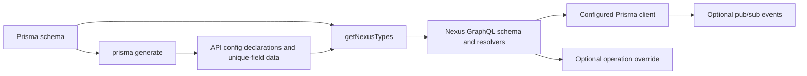

# Contributing

[Project overview and consumer API guide](README.md)

This guide is for maintainers and contributors changing the generator package or its stateful usage
example. It explains the system boundary, normal workflows, generated outputs, side effects, and
verification expected before handoff.

## Contents

- [System model](#system-model)
- [Prerequisites and setup](#prerequisites-and-setup)
- [Generator workflow](#generator-workflow)
- [Usage application workflow](#usage-application-workflow)
- [Generated outputs and side effects](#generated-outputs-and-side-effects)
- [Verification](#verification)

## System Model

The repository contains two pnpm workspaces. `packages/generator` publishes
`prisma-nexus-api`; `packages/usage` is a private Apollo Server application that consumes the local
workspace package as a composed example.

Prisma's DMMF is the schema metadata consumed by the generator. During `prisma generate`, the
package derives API configuration declarations and unique-field information from that metadata. At
application startup, `getNexusTypes` reads a Prisma schema, derives Nexus input, output, model,
query, mutation, and scalar types, and attaches resolvers. Resolvers either call the configured
Prisma client or transfer full responsibility to a configured override. Mutation helpers can also
publish events through the optional pub/sub engine. The existing [consumer guide](README.md)
remains canonical for public configuration and override behavior.



## Prerequisites and Setup

Use Node.js 16 or newer. Continuous integration installs pnpm 7. From the repository root, install
all workspace dependencies:

```sh
pnpm install
```

The generator can be built and tested without a database. The usage application requires a
PostgreSQL database and a `DATABASE_URL` accepted by the datasource in
`packages/usage/prisma/schema.prisma`. Docker Compose is available for a local database and pgAdmin,
but connection values must come from the maintainer's environment; do not commit secrets.

## Generator Workflow

Run package commands from the root:

```sh
pnpm --dir packages/generator build
pnpm --dir packages/generator lint
pnpm --dir packages/generator test
```

Use `pnpm --dir packages/generator dev` when a TypeScript watch build is useful. The package entry
point exports Nexus generation and API configuration types; its CLI entry point registers the
Prisma generator. Changes to schema interpretation should be checked at both boundaries: generated
configuration declarations and runtime Nexus types/resolvers.

## Usage Application Workflow

After setting `DATABASE_URL`, optionally start the repository's local services:

```sh
pnpm --dir packages/usage dockerCompose
```

Then run the development application:

```sh
pnpm --dir packages/usage dev
```

The development script runs Prisma generation, applies development migrations, and starts the
TypeScript Apollo Server. The server listens on port 4000. The `start` script performs the same
stateful preparation after compiling the application.

Migration failure or an unavailable database prevents startup. Stop the foreground application or
Compose process before changing connection settings. To remove the Compose containers and network
without requesting volume deletion, run:

```sh
docker compose -f packages/usage/.docker/docker-compose.yaml down
```

Review schema and migration changes before committing them; migration directories are durable
history, not ordinary generated scratch files.

## Generated Outputs and Side Effects

- Building the generator writes compiled package output under its configured TypeScript output.
- Prisma generation writes `apiConfig.d.ts` to the configured generator output, or to the
  generator's default output when none is configured.
- Generator execution refreshes `packages/generator/src/_types/uniqFields.json` from model ID and
  unique fields. Do not hand-maintain that data independently of the generator.
- The usage application's Nexus build writes `schema.graphql` and `nexus.ts` beneath a
  `generated/nexus` directory relative to the running source or compiled entry point.
- `prisma migrate dev` changes the configured database and can create migration history when the
  schema has changed. Inspect both effects before handoff.
- Default mutation helpers write through Prisma before publishing optional events. Operation
  overrides replace the default call, as documented in the consumer guide.

## Verification

Choose checks by affected boundary:

```sh
pnpm --dir packages/generator lint
pnpm --dir packages/generator test
pnpm --dir packages/generator build
pnpm --dir packages/usage compile
```

For generator or integration behavior, also run `prisma generate` against a representative schema
and inspect the generated declaration and unique-field outputs. For usage-runtime changes, run the
application against a disposable PostgreSQL database and verify schema creation and a representative
GraphQL operation. Report database, migration, generated-file, or operating-system boundaries that
were not exercised. The repository CI workflow covers generator tests and build work on its
configured operating-system matrix; local usage compilation and database behavior remain separate
checks.
