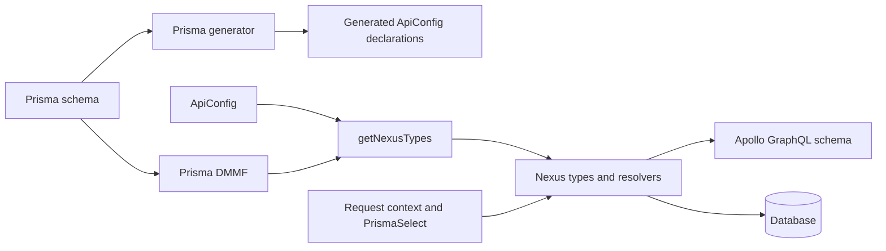

# Architecture

> Parent: [Documentation index](README.md)

This guide is for maintainers changing `prisma-nexus-api` or its usage application. It explains the
implemented package boundaries, generated artifacts, runtime flow, and contracts whose changes can
affect consumers.

## Contents

- [System model](#system-model)
- [Generation flow](#generation-flow)
- [Runtime schema flow](#runtime-schema-flow)
- [Operations and extension points](#operations-and-extension-points)
- [Compatibility boundaries](#compatibility-boundaries)

## System Model

The workspace has two maintained packages:

- `packages/generator` is the published library and Prisma generator. It generates an `ApiConfig`
  declaration from a Prisma data model and builds Nexus types and resolvers at runtime.
- `packages/usage` is a private example application. It supplies a Prisma schema and client,
  converts GraphQL selections into Prisma selections, builds a Nexus schema, and serves it through
  Apollo Server.

DMMF is Prisma's structured representation of models and operations. Nexus uses the returned type
definitions to assemble the executable GraphQL schema.

## Generation Flow

A Prisma schema registers the `prisma-nexus-api` provider. During `prisma generate`, the generator
reads the schema's DMMF, derives model field and operation types, records unique fields, and writes
an `apiConfig.d.ts` declaration to the configured generator output or its default output.
Generation is a write operation: generated declarations and unique-field lookup data must agree
with the current Prisma schema.

The generated configuration narrows model names, removable fields, and override result types for a
consumer's schema. It does not itself start a server or migrate a database.

## Runtime Schema Flow

`getNexusTypes` reads the Prisma schema, derives DMMF, and combines it with `ApiConfig`. Global
configuration under `data.all` and model-specific configuration determine which models, fields,
inputs, queries, mutations, and nested writes are exposed. The result includes Prisma-derived
object and input types, CRUD operation fields, `BatchPayload`, and supported custom scalars unless
a scalar is excluded.

Resolvers expect request context to provide a Prisma client and, for selected fields, a selection
object. The usage application creates that selection with `PrismaSelect` middleware before a
resolver invokes the matching Prisma model operation.

## Operations and Extension Points

Read and mutation configuration can disable operation groups or individual operations. A
model-specific override takes precedence over the corresponding `data.all` override. Once an
override is selected, it owns the Prisma call and returned value; the default resolver path is not
also executed.

Default create, update, upsert, and delete helpers execute Prisma mutations and optionally publish
model event payloads through the configured `PubSubEngine`. Multi-record delete first reads unique
fields for affected records. These helpers cross database and event-publication boundaries, so
changes require verification of result shapes, selection handling, event names, and partial-failure
behavior.

## Compatibility Boundaries

Treat these as public or generated contracts:

- exported package entry points and TypeScript types;
- `ApiConfig` structure and model/operation configuration semantics;
- GraphQL model, input, scalar, query, mutation, and `BatchPayload` names;
- override option fields, precedence, and responsibility for calling Prisma;
- notification helper names, event naming, and payload shapes;
- Prisma generator provider, output behavior, and generated declaration shape;
- resolver expectations for Prisma and selection data in request context.

The usage package is an example rather than the published package, but it is the repository's
composed integration path. Keep it aligned when a public generator or runtime contract changes.
