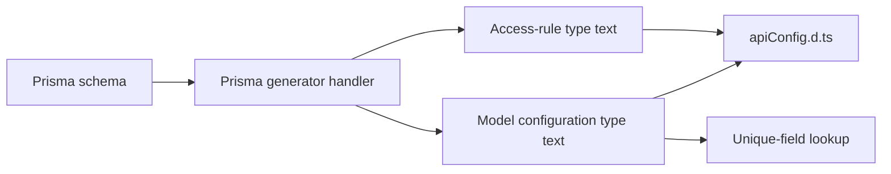

# Generator package

> Parent: [Parent index](README.md)

[Back to the component index](README.md)

## Table of contents

- [Purpose](#purpose)
- [Public surfaces](#public-surfaces)
- [Generation path](#generation-path)
- [Runtime schema path](#runtime-schema-path)
- [Configuration and operations](#configuration-and-operations)
- [Verification](#verification)

## Purpose

`packages/generator` is the publishable `prisma-nexus-api` package. It provides a Prisma generator CLI and runtime exports for building Nexus types from a Prisma schema. Evidence: [`packages/generator/package.json`](../../packages/generator/package.json), [`packages/generator/src/bin.ts`](../../packages/generator/src/bin.ts), and [`packages/generator/src/index.ts`](../../packages/generator/src/index.ts).

## Public surfaces

The package maps the `prisma-nexus-api` executable to `dist/bin.js`. Source `bin.ts` starts the Prisma generator, while source `index.ts` exports Nexus types and `ApiConfig`. The compiled JavaScript and declaration files under `dist/` are package outputs, not maintained source. Evidence: [`packages/generator/package.json`](../../packages/generator/package.json), [`packages/generator/src/bin.ts`](../../packages/generator/src/bin.ts), and [`packages/generator/src/index.ts`](../../packages/generator/src/index.ts).

## Generation path



The handler consumes Prisma DMMF data, combines access-rule and model-configuration declarations, and writes `apiConfig.d.ts` to the configured output or its default. Unique model fields are collected into `_types/uniqFields.json`. The write helper creates parent directories and writes the requested content. Evidence: [`packages/generator/src/prismaGenerator/index.ts`](../../packages/generator/src/prismaGenerator/index.ts), [`packages/generator/src/prismaGenerator/genApiConfigAccessRules.ts`](../../packages/generator/src/prismaGenerator/genApiConfigAccessRules.ts), [`packages/generator/src/prismaGenerator/genApiConfigTypes.ts`](../../packages/generator/src/prismaGenerator/genApiConfigTypes.ts), and [`packages/generator/src/utils/writeFileSafely.ts`](../../packages/generator/src/utils/writeFileSafely.ts).

## Runtime schema path

`getNexusTypes` reads a Prisma schema, builds DMMF data, and constructs enums, inputs, aggregate/count outputs, model objects, enabled queries and mutations, `BatchPayload`, and non-excluded scalars. Configuration can remove models or fields, suppress nested writes, disable operations, and provide overrides. Evidence: [`packages/generator/src/nexusTypes/index.ts`](../../packages/generator/src/nexusTypes/index.ts), [`packages/generator/src/_types/genericApiConfig.ts`](../../packages/generator/src/_types/genericApiConfig.ts), and [`packages/generator/src/nexusTypes/scalars/index.ts`](../../packages/generator/src/nexusTypes/scalars/index.ts).

## Configuration and operations

`ApiConfig` requires a Prisma client and an `all` model configuration; a pub/sub engine is optional. Query resolvers call Prisma by default and allow model-specific overrides before all-model overrides. Mutation resolvers use the same override precedence and otherwise call helpers that may publish create, update, or delete events. Override functions replace the default Prisma call. Evidence: [`packages/generator/src/_types/apiConfig.ts`](../../packages/generator/src/_types/apiConfig.ts), [`packages/generator/src/nexusTypes/queries/findMany.ts`](../../packages/generator/src/nexusTypes/queries/findMany.ts), [`packages/generator/src/nexusTypes/mutations/createOne.ts`](../../packages/generator/src/nexusTypes/mutations/createOne.ts), and the preserved [`packages/generator/README.md`](../../packages/generator/README.md).

## Verification

The package manifest defines `test`, `build`, and `lint`; CI is configured to run the first two after installation. These commands are unverified because the inventory contains no controlled execution result:

```text
pnpm --dir packages/generator test
pnpm --dir packages/generator build
pnpm --dir packages/generator lint
```

Evidence: [`packages/generator/package.json`](../../packages/generator/package.json) and [`.github/workflows/CI.yml`](../../.github/workflows/CI.yml).
