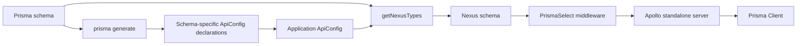

# From Prisma schema to running GraphQL API

> Parent: [Parent index](README.md)

[Back to the feature index](README.md)

## Table of contents

- [Overview](#overview)
- [Generate configuration types](#generate-configuration-types)
- [Build Nexus types at runtime](#build-nexus-types-at-runtime)
- [Serve GraphQL requests](#serve-graphql-requests)
- [Verification and gaps](#verification-and-gaps)

## Overview

The repository demonstrates a two-stage flow: Prisma generation emits schema-specific TypeScript configuration declarations, then application startup reads a Prisma schema again to construct Nexus types and operations at runtime.

Evidence: [`README.md`](../../README.md), [`packages/generator/src/prismaGenerator/index.ts`](../../packages/generator/src/prismaGenerator/index.ts), [`packages/generator/src/nexusTypes/index.ts`](../../packages/generator/src/nexusTypes/index.ts), and [`packages/usage/src/index.ts`](../../packages/usage/src/index.ts).

## Generate configuration types

The Prisma generator handler receives DMMF data, creates model-specific fields and operation configuration types, records unique fields, and writes `apiConfig.d.ts` to the configured output or default output. The public README instructs consumers to register `prisma-nexus-api` as a Prisma generator and run `npx prisma generate`; this command is unverified here. Evidence: [`README.md`](../../README.md), [`packages/generator/src/prismaGenerator/index.ts`](../../packages/generator/src/prismaGenerator/index.ts), and [`packages/generator/src/prismaGenerator/genApiConfigTypes.ts`](../../packages/generator/src/prismaGenerator/genApiConfigTypes.ts).

## Build Nexus types at runtime

The application supplies a Prisma client and configuration to `getNexusTypes`. Runtime construction uses Prisma DMMF to create exposed types and enabled CRUD operations. Removed fields and disabled operations are applied globally or per model. Model-specific overrides take precedence over all-model overrides. Evidence: [`packages/usage/src/index.ts`](../../packages/usage/src/index.ts), [`packages/generator/src/nexusTypes/index.ts`](../../packages/generator/src/nexusTypes/index.ts), [`packages/generator/src/nexusTypes/utils.ts`](../../packages/generator/src/nexusTypes/utils.ts), and [`packages/generator/src/_types/genericApiConfig.ts`](../../packages/generator/src/_types/genericApiConfig.ts).

## Serve GraphQL requests

The example builds the Nexus schema, applies `PrismaSelect` middleware, and starts Apollo on port 4000. The middleware puts selection data in context; operation resolvers merge it into Prisma parameters before an override or default Prisma call. Evidence: [`packages/usage/src/index.ts`](../../packages/usage/src/index.ts), [`packages/generator/src/nexusTypes/queries/findUnique.ts`](../../packages/generator/src/nexusTypes/queries/findUnique.ts), and [`packages/generator/src/nexusTypes/mutations/updateOne.ts`](../../packages/generator/src/nexusTypes/mutations/updateOne.ts).

## Verification and gaps

The usage `dev` and `start` scripts combine generation, migration, compilation, and server startup, but no controlled run is supplied. Database availability, migration success, generated declaration correctness for the example schema, and a successful GraphQL request remain unverified. Subscription transport is also not implemented in the example source.

Evidence: [`packages/usage/package.json`](../../packages/usage/package.json), [`packages/usage/prisma/schema.prisma`](../../packages/usage/prisma/schema.prisma), [`packages/usage/prisma/migrations/20230629190044_init/migration.sql`](../../packages/usage/prisma/migrations/20230629190044_init/migration.sql), and [`packages/usage/src/index.ts`](../../packages/usage/src/index.ts).
