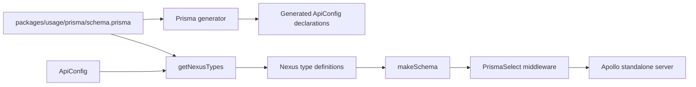

# Prisma Schema to Running GraphQL Server

Parent: [features index](README.md)

## Contents

- [Outcome](#outcome)
- [Workflow](#workflow)
- [Configuration effects](#configuration-effects)
- [Side effects and failures](#side-effects-and-failures)
- [Verification](#verification)

## Outcome

The repository connects two related paths: the package's Prisma generator creates schema-specific
configuration declarations, while the usage application reads the Prisma schema at runtime and
builds an executable Nexus schema for Apollo Server.

## Workflow

`packages/generator/src/prismaGenerator/index.ts` handles the generation path and writes an
`apiConfig.d.ts` file. `packages/generator/src/nexusTypes/index.ts` handles runtime DMMF conversion.
`packages/usage/src/index.ts` supplies configuration, assembles the schema, applies middleware, and
starts Apollo.

## Configuration Effects

`ApiConfig.data.all` supplies defaults across models, while named model entries supply local
configuration. The runtime builder can filter fields and nested inputs, omit models, disable
operation groups or individual operations, and install resolver overrides. Scalar exclusions are
supplied separately to `getNexusTypes`.

The example uses PrismaSelect middleware so resolver information becomes a Prisma selection in
`ctx.select`. Query and mutation code consumes context selection when constructing Prisma
parameters.

## Side Effects and Failures

Generation writes declaration and unique-field files. The usage `dev` and `start` scripts also run
Prisma generation and migrations before starting the process. Mutation helpers can write database
records and optionally publish events.

The inventoried implementation does not document transaction, retry, shutdown, migration recovery,
or event-delivery guarantees. These must be established by implementation evidence before making
such claims.

## Verification

A complete workflow check should independently observe:

1. Dependency installation.
2. Generator compilation and tests.
3. Prisma generation from `packages/usage/prisma/schema.prisma`.
4. Database migration against an explicitly selected disposable environment.
5. Nexus schema and typegen creation.
6. Apollo startup and a representative query and mutation through PrismaSelect middleware.
7. Relevant override and PubSub behavior when those contracts change.

No controlled execution was included in the inventory, so these checks remain unverified.
